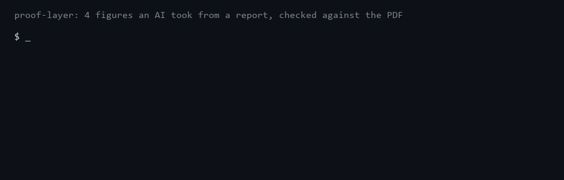

# proof-layer

I've used AI every day for about two years. It kept making up figures, telling me what I wanted to hear, and reporting work as done when it wasn't, most often when I asked it to work with data. So I built proof-layer: instead of trusting the AI's word, it checks each number against the source. It's useful wherever knowing where a number came from matters most.

**Every number your AI pulls from a document, checked against that document.**



In the picture, the AI mixed up two items: it gave Scope 2's number (19,691) as Scope 1, so that one is **wrong**, and it gave a Scope 3 figure the report doesn't contain, so that one is **to check**. The other two are **correct**.

An AI reads a report and writes "Scope 1 emissions: 19,691". proof-layer confirms that number is in the document, and that it belongs to Scope 1. Right numbers pass straight through. Wrong ones are stopped. If it can't tell, it asks instead of guessing.

## Use it in 3 steps

1. **Ask your AI the way [PROMPT.md](PROMPT.md) says.** It answers with each figure plus its page and the exact quote it came from. Save the reply as `answer.json`. Works with any AI that can read your PDF.
2. **Run `proof-layer report.pdf answer.json`.** Code checks that each quote really is on that page and the number really is in it.
3. **Settle the rest in one go.** Add `--ask-ai items.json`: it writes the few figures code can't settle, with the text around them. Your AI answers yes, no or unsure, and `--answers answers.json` applies that. What is still left comes with a picture of the page, number highlighted (`--sheet check.html`).

## What to expect (measured)

- **Wrong numbers are stopped.** On 5 real documents (climate, finance and government reports) every one of 888 and 1,247 deliberately wrong numbers was stopped with plain wording, and 1,244 of 1,247 with padded wording. 
- **With figure, page and quote, few reach you.** In small tests: 2 of 43 figures on two climate reports, and 6 of 55 on the Reserve Bank's annual report and a Deloitte government review. About 8 in 100 overall, each with a reason and a picture.
- **Without quotes, more do.** If your AI gives only a sentence, proof-layer has to guess which item each number belongs to: 43 in 100 came back as "check" on the climate reports and 80 in 100 on the finance and government ones. That is why step 1 asks for quotes.
- **A "yes" from your AI can't approve an invented number.** It only counts when the number is already in the saved text and that text is on the PDF page. In a test, 0 of 87 wrong claims passed.
- **Same checks every time.** The checking is fixed code. The AI step is optional and only answers "is this number that item?".

These are small tests, on five documents, with answers written by a Sonnet helper, so treat them as a guide. The AI's "yes" answers were not each checked by hand.

## How it fits into your work

proof-layer is meant for any job where an AI states numbers it took from a PDF and you need them right. The example below is one case; yours will look different.

**Example:** you're preparing a client's climate disclosure from 40 company reports.

1. **Your AI extracts the figures,** each with its page and quote (500 numbers).
2. **proof-layer checks all 500.** Most pass straight through, already confirmed against the source.
3. **The rest come back with a one-line reason,** the page, and a picture. Your AI settles most; you look at the few left.
4. **You send the spreadsheet knowing every figure was checked against its source.**

**What it needs:** a PDF with a text layer (not a scan or photo), and numbers that are written in it. It checks that a number is there and belongs to the right item; it does not judge whether the document itself is right. Figures your AI works out itself (a share, a sum) are flagged for you, because they are not printed in the document. Figures written as "5.2 million" are always shown to you.

## What you get back

| Outcome | What it means | What to do |
|---|---|---|
| **Passed** | The number is written where the page talks about this item | Nothing. Use it |
| **Stopped** | The number isn't on the page, or it belongs to something else | Correct it. In testing, nearly all of these were real errors |
| **Confirm** | The page has several places that fit, or none that clearly does, so it asks you instead of guessing | A quick look, or give a more specific description and run it again |

Only "Passed" passes. A "can't tell" is never treated as fine.

In the code: `FOUND_IN_ROW` = Passed; `WRONG_FOR_LABEL` and `ABSENT` = Stopped; `AMBIGUOUS_LABEL` and `UNKNOWN` = Confirm.

## Works alongside RAG and cite-your-source prompts

| | What it gives you | Where proof-layer comes in |
|---|---|---|
| **RAG** (search the documents, then answer) | Finds the right passage for the AI | Checks the number the AI wrote from that passage |
| **"Cite your source" prompts** | Shows where the AI says a number came from | Checks the number is really there |
| **A second AI as reviewer** | Another opinion | A fixed check that gives the same answer every time and costs nothing per number |

Keep what you have. proof-layer is the last step before the numbers go out.

## Who it's for

Anyone who stands behind figures that an AI read from documents: sustainability and audit teams, finance, procurement and compliance teams working from contracts, invoices and filings, and products that show users figures from their own documents.

## An example, start to finish

**The situation.** A sustainability consultant is preparing a client's climate disclosure. By law, companies now have to report their emissions and energy use, and an auditor will later pick figures at random and ask: *where did this number come from?* The consultant's source is the client's own 80-page sustainability report (a PDF). Copying figures out of it by hand takes days, so she has an AI read the report and fill in the disclosure table.

**The risk.** The AI is usually right, but not always. It might copy the Scope 2 figure into the Scope 1 box (they sit next to each other in the report). Or the table has a Scope 3 line and the AI fills it in even though the report never gives one. If that reaches the auditor, the consultant is the one who signed it.

**What goes in.** Two things she already has:
1. **The report**, as the PDF.
2. **The AI's filled-in table**, which says:

| Disclosure line | AI's figure |
|---|---|
| Scope 1 emissions | 5,845 |
| Scope 1 emissions (second try) | 19,691 |
| Total energy consumption | 1,074,807 |
| Scope 3 emissions | 5,845 |

**What she wants back.** Which figures are safe to submit, which are wrong, and for each one, the page and line of the report it comes from, so she can answer the auditor.

**1. Save the AI's table** as a file, `results.json`. If your software produced it, it's probably already in this form:

```
[
  {"name": "Scope 1 emissions", "value": 5845},
  {"name": "Scope 1 emissions", "value": 19691},
  {"name": "Total energy consumption", "value": 1074807},
  {"name": "Scope 3 emissions", "value": 5845}
]
```

**2. Run one command** with the PDF and that file (install first with `pip install ".[pdf]"`):

```
proof-layer sample_report.pdf results.json
```

**3. Read the answer.** It looks every number up in the PDF:

```
CORRECT  Scope 1 emissions = 5,845, page 1
WRONG    Scope 1 emissions = 19,691, page 1
         The report has, on page 1: Scope 1 emissions (tCO2-e) 5,845 6,102
CORRECT  Total energy consumption = 1,074,807, page 1
CHECK    Scope 3 emissions = 5,845
         The report doesn't clearly talk about this, though the number does appear elsewhere in it.

2 of 4 need your attention: 1 wrong, 1 to check.
```

- **Scope 1 = 5,845:** correct, found on page 1.
- **Scope 1 = 19,691:** wrong. That number is in the report, but it belongs to Scope 2. It shows you the line the report has for Scope 1.
- **Total energy = 1,074,807:** correct.
- **Scope 3 = 5,845:** it won't guess. Nothing in the report clearly talks about Scope 3, so it says check.

So she can submit 2 figures with the page to point to, fix 1 (it caught the Scope 1/Scope 2 mix-up), and chase 1 (the report has no Scope 3 figure, so the AI made it up or took it from elsewhere). That took seconds, and she only opened the PDF for that last one.

**No table? Paste the answer instead.** If you just have the AI's written reply, save it as `answer.txt` and run `proof-layer sample_report.pdf answer.txt`. It finds every figure in the text and checks each one the same way (try `examples/ai_answer.txt`). Figures written as "5.2 million" are handed to you to check by eye.

**Let your AI settle the rest.** Some figures can't be settled by code alone, because a PDF's text often comes out with a number far from its label. `proof-layer report.pdf results.json --ask-ai items.json` writes those figures with the text around each, and instructions your AI can follow. Give its yes/no/unsure answers back with `--answers answers.json`. A "yes" only counts if the number is really in the saved text and that text is really on the PDF page, so the AI can't approve an invented number. In a test on 43 figures from two real reports, the tool alone asked for a look at 28; with an AI's answers it was 2 (one the AI said "unsure" about, and one that was really wrong). That is a small test: the AI's answers were not checked beyond those 43 and a separate set of 87 deliberately wrong claims, none of which it passed.

**Want to see what it's asking about?** Add `--sheet check.html`: `proof-layer sample_report.pdf results.json --sheet check.html`. It writes one page with a picture of the PDF around each figure that needs a look, the number highlighted. A glance settles most of them. (In a test on 43 figures from two real reports, 24 of the 28 needing a look got a picture.)

**Figures kept in a database?** If each stored figure also has the text it was taken from, add that as `source_text` (and `page` if you have it) in `results.json`. It then checks two things: the stored number really is in that text, and that text really is in the PDF, on that page. It catches a number that drifted after extraction and a saved quote that isn't in the document. Try `examples/stored_rows.json`.

`sample_report.pdf` is a made-up one-page report in the `examples` folder, so you can run this yourself. You don't need page numbers: it searches the whole PDF and tells you the page. It exits with 1 if anything needs attention, so it can also stop a pipeline.

## Install and quickstart

```
pip install .
```

```python
from proof_layer.locate import check_claim

page = """Scope 1 emissions 5,845 6,102
Scope 2 emissions 19,691 18,400"""

# The right number, where the page discusses Scope 1: passes.
assert check_claim("Scope 1 emissions", 5845, page)["verdict"] == "FOUND_IN_ROW"

# 19,691 is on the page, but it is the Scope 2 figure: stopped.
assert check_claim("Scope 1 emissions", 19691, page)["verdict"] == "WRONG_FOR_LABEL"

# A number that isn't on the page at all: stopped.
assert check_claim("Scope 1 emissions", 5846, page)["verdict"] == "ABSENT"

# Nothing on the page is about Scope 3, so it asks instead of guessing.
assert check_claim("Scope 3 emissions", 5845, page)["verdict"] == "UNKNOWN"
```

## Results

Tested on two real public company sustainability reports (Alinta Energy FY25 and Geelong Port 2025), version 0.1.0. I took 189 real numbers from them, then made 888 deliberately wrong versions: a digit changed, two digits swapped, multiplied by ten, the sign flipped, or a number borrowed from elsewhere on the same page. Numbers that are part of their own description ("Scope 3", "wharf 7") were left out, because there is nothing to check there.

| | Wrong numbers stopped | Right numbers it asks you to confirm |
|---|---|---|
| Only checking the number appears somewhere on the page | 76 in 100 | 0 |
| **proof-layer, one page** | **100 in 100** (888 of 888) | **24 in 100** |
| **proof-layer, whole PDF, no page number** (what the command does) | **100 in 100** (888 of 888) | **43 in 100** |

When it asks you to confirm because the wording fits several places, it also tells you the page where it found your number, so the check is one look, not a search. The ones it asks you to confirm are not errors. They are numbers it won't guess at, mostly short ones ("2", "10") or wording that appears in several tables of one report, like "Total water". Searching the whole PDF finds more places that fit, so it asks more often. In the test the descriptions are just the words printed before each number, often fragments like "GRI" or "more than". With descriptions of 4 or more words, whole-PDF mode asked about 30 in 100 (18 of 60). Most of what remains is real ambiguity, like "Total Scope 1+2 emissions" appearing in 6 to 11 places with different numbers. The test used a random sample of all the numbers in both reports, including index tables and chart labels, so real reports with clearer descriptions should ask less. Wrong numbers that passed in this test: 0 of 889. An earlier version let a number through when it was only the digit in the item's name (item "Scope 3", number 3); that is fixed and covered by a test.

**Beyond climate reports.** The same test on three documents from other fields (the Reserve Bank of Australia's annual report, a Deloitte compliance review for a government department, and a third government PDF): 1,247 wrong numbers, **1,244 stopped (99.8 in 100)** with padded wording, all 1,247 with plain wording. 80 in 100 right numbers came back as "check", against 43 in 100 on the climate reports. So the safety carried over; the effort did not. These documents are laid out more densely, and the test's descriptions are just the scrap of text printed before each number, which is a harsh test. The 3 that got through shared one cause: a number on the line below a reference ("Table 2.2.3; see also Part 3.3") was taken as that row's figure. Whether your AI's own descriptions bring the 80 in 100 down is not measured here.

Run it yourself: `python -I benchmarks/whole_document_wrong_numbers.py out.json report1.pdf report2.pdf` (or `located_wrong_numbers.py` for one page at a time; needs `pip install ".[benchmarks]"`).

## Tips for the best results

- **Be specific in the description of each figure.** It is the one thing you control. Write it the way the report words it, and add whatever makes the item unique: the table name, "market-based", the scope number. "Water withdrawn in water-stressed areas" passes where "Total water" would ask you to confirm. A quick way: copy the words from the line in the PDF.
- **Include the unit in your results where you can.** A `unit` of `m`, `m2`, `hours`, `%` or `storeys` stops a 3 metre figure being matched to "3 hours of sunlight". Other units (tonnes, GJ, ML) are accepted but make no difference yet.
- **A number that sits on the same line for another reason (a date, a year): it is on the line, so it passes. Two years side by side on one line:** it confirms the number is on the line but doesn't pick the year.

## What's inside

- `proof_layer/locate.py`: finds the part of the page that discusses the item, then checks the number there.
- `proof_layer/integrity.py`: the number check itself. It recognises the legitimate ways a number can be written differently (35% as 0.35, 900 mm as 0.9 m).
- `tests/`: 105 passing tests, plus 6 marked expected failures that record the cases above. The code above is run as a test.
- `benchmarks/`: the test scripts and saved results.

Apache-2.0. Copyright 2026 Lawrence McDonell.
